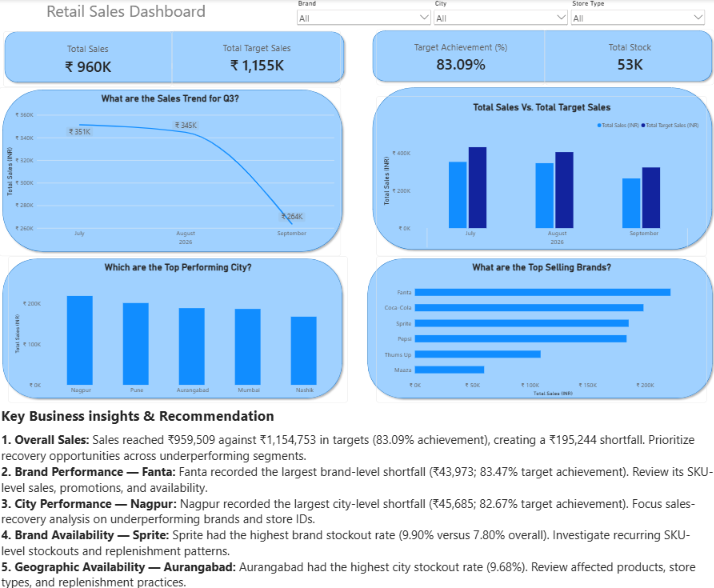
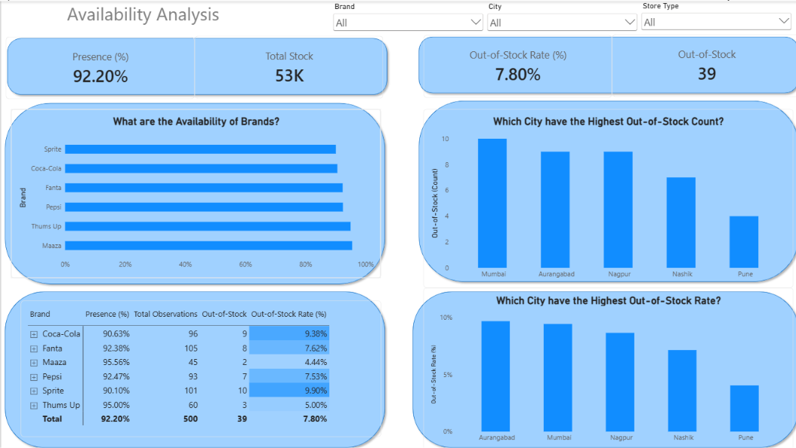
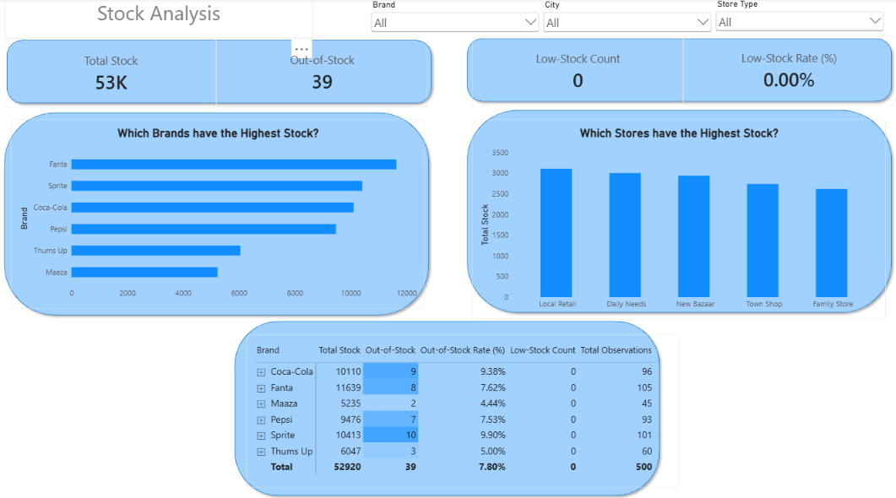
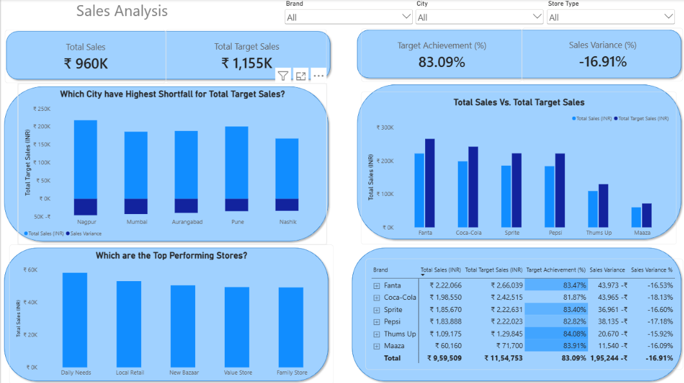
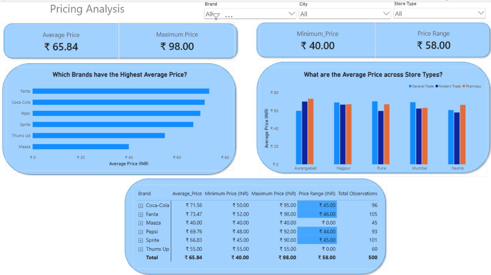

# Retail Execution Analytics Dashboard | Power BI

An interactive **Power BI Retail Execution Dashboard** designed to analyze sales performance, product availability, recorded stock quantities, and pricing across brands, cities, and retail channels. The report transforms an Excel-based retail execution dataset into a decision-support tool with a star-schema data model, reusable DAX measures, and actionable business recommendations.

## Project overview

The analysis uses **500 retail observations** spanning **July 1–September 28, 2026**, covering **6 brands**, **5 cities**, **10 SKUs**, and **3 store types**. The objective is to track performance against sales targets, identify availability issues, and explore product-level price variation.

### Business questions

- How are actual sales performing against targets?
- Which brands and cities have the largest sales shortfalls?
- Where are zero-stock observations most frequent?
- How do recorded stock quantities vary across brands and store identifiers?
- How do unit prices differ across products, cities, and store types?

## Dashboard pages

| Page | What it covers |
| --- | --- |
| **Executive Summary** | Sales, target achievement, stock, presence, stockouts, pricing KPIs, trends, and business recommendations. |
| **Availability Analysis** | Product presence by brand, zero-stock observations by city, and drill-down availability metrics. |
| **Stock Analysis** | Recorded stock by brand and store identifier, stockout rates, and threshold-based low-stock measures. |
| **Sales Analysis** | Actual versus target sales, top store identifiers by sales, variances, and drill-down performance. |
| **Pricing Analysis** | Average, minimum, and maximum unit prices, price ranges, city/store-type comparisons, and SKU-level analysis. |

All five pages use slicers for **City, Brand, and Store Type**.

## Key results

The following findings were validated during development with all report filters cleared.

| Metric | Value |
| --- | ---: |
| Total sales | ₹959,509 |
| Target sales | ₹1,154,753 |
| Target achievement | **83.09%** |
| Sales variance | **−₹195,244** |
| Product presence rate | **92.20%** |
| Zero-stock observations | **39 of 500 (7.80%)** |
| Sum of recorded stock quantities | **52,920** |
| Average recorded unit price | **₹65.84** |

### Actionable business insights

1. **Overall sales missed target by ₹195,244 (16.91%).** Prioritize a review of segments with the largest recoverable gaps and track progress against targets.
2. **Fanta had the largest brand-level sales shortfall:** **−₹43,973**, with **83.47%** target achievement. Investigate SKU performance, promotion execution, pricing, and availability.
3. **Nagpur had the largest city-level sales shortfall:** **−₹45,685**, with **82.67%** target achievement. Focus review on the contributing brands and store identifiers.
4. **Sprite had the highest brand stockout rate: 9.90%.** Review the product/store combinations and replenishment processes associated with repeated zero-stock observations.
5. **Aurangabad had the highest city stockout rate: 9.68%.** Examine affected products and retail channels before targeting replenishment improvements.

> **Interpretation note:** The analysis identifies patterns and investigation priorities, not proven causes. In particular, the dataset does not establish that stockouts caused the sales shortfall.

## Data model

The report uses a **star schema** with the central `Fact_RetailExecution` table related to:

- `Dim_Date`
- `Dim_Product`
- `Dim_Store`
- `Dim_City`
- `Dim_StoreType`
- `Dim_SalesRep`

Relationships are **one-to-many**, with **single-direction filtering** from each dimension to the fact table. A disconnected `_Measures` table organizes reusable calculations.

**Source fields include:** `Date`, `Region`, `City`, `Store ID`, `Store Name`, `Store Type`, `Sales Rep`, `Brand`, `SKU`, `Presence`, `Stock Qty`, `Unit Price`, `Sales Qty`, `Sales Value`, `Target Sales`, and `Promotion Flag`.

## DAX examples

```dax
Total Sales =
SUM(Fact_RetailExecution[Sales Value])

Total Target Sales =
SUM(Fact_RetailExecution[Target Sales])

Target Achievement % =
DIVIDE([Total Sales], [Total Target Sales], 0)

Sales Variance =
[Total Sales] - [Total Target Sales]

Sales Variance % =
DIVIDE([Sales Variance], [Total Target Sales], 0)

Out-of-Stock Count =
CALCULATE(
    COUNTROWS(Fact_RetailExecution),
    Fact_RetailExecution[Stock Qty] = 0
)

Total Observations =
COUNTROWS(Fact_RetailExecution)

Out-of-Stock Rate =
DIVIDE([Out-of-Stock Count], [Total Observations], 0)

Average Price =
AVERAGE(Fact_RetailExecution[Unit Price])

Minimum Price =
MIN(Fact_RetailExecution[Unit Price])

Maximum Price =
MAX(Fact_RetailExecution[Unit Price])

Price Range =
[Maximum Price] - [Minimum Price]
```

The report also includes a **low-stock observation measure**, defined for this exercise as `Stock Qty > 0` and `Stock Qty < 15`. This **15-unit threshold is an analytical assumption**, not a business-approved replenishment threshold.

## Tools and techniques

- **Power BI Desktop** — interactive reporting and visualization
- **Power Query** — data preparation and data-type validation
- **DAX** — reusable KPIs, variance calculations, and filter-aware measures
- **Data modelling** — star-schema design, dimension tables, relationship validation
- **Excel** — source data and independent result reconciliation
- **Analytical storytelling** — business findings and prioritized recommendations

## Data validation

Key checks performed during the project included:

- Reviewing source data types and record counts.
- Validating sales totals and target achievement against Excel.
- Reconciling stockout counts and rates with the 500 observations.
- Checking active relationships and dimension filtering.
- Testing page slicers and chart interactions.
- Distinguishing average recorded unit price from a sales-weighted price.

## Analytical limitations

- **Stock is observational:** `Total Stock` sums quantities recorded across dates. It is **not** a current on-hand inventory snapshot.
- **Store identifiers are not confirmed physical-store keys:** Store IDs can occur across cities. Store-level charts should be interpreted as Store ID-level aggregates, not necessarily distinct physical locations.
- **Pricing mixes products:** The overall average unit price is an observation-level mean. Differences between brands or cities may reflect differing SKU mixes, promotions, or observation dates. Comparisons of the **same SKU** are more informative.
- **Low-stock threshold is illustrative:** The 15-unit threshold should be revisited with business context, demand, and replenishment lead times.
- **Descriptive analysis is not causal:** The report cannot establish why sales missed target or whether stockouts caused lost sales.

## How to open the report

1. Install **Power BI Desktop**.
2. Clone or download this repository.
3. Open the `.pbix` file from the `dashboard/` directory (if included).
4. If prompted to refresh, update the Excel source location in **Transform data → Data source settings** and provide an authorized copy of the data.
5. Use the City, Brand, and Store Type slicers to explore the report.

## Screenshots

### Executive Summary


### Availability Analysis


### Stock Analysis


### Sales Analysis


### Pricing Analysis
